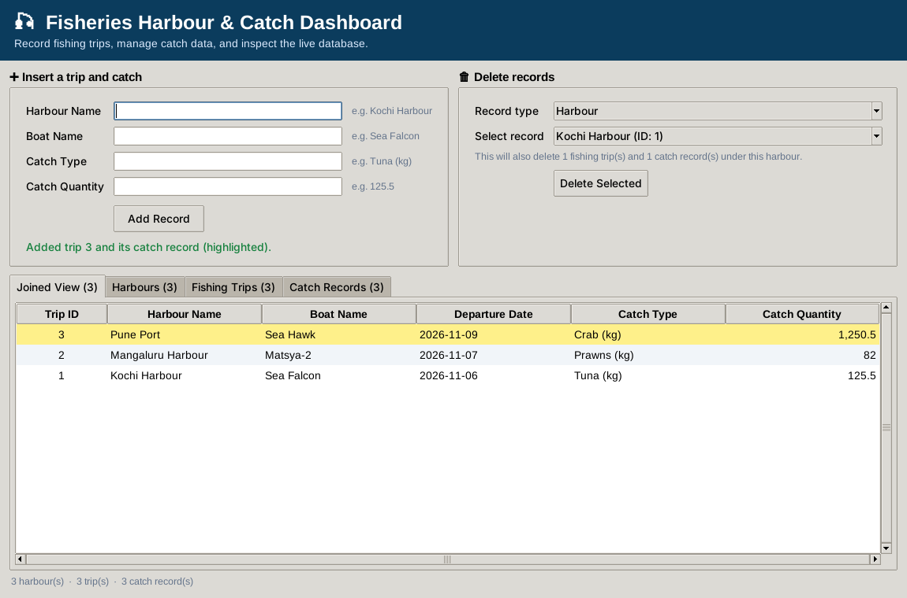

# 🎣 Fisheries Harbour & Catch Recording Dashboard

A single-file Python application that replaces a spreadsheet-based catch tracker with a relational **SQLite** database and a simple dashboard. It tracks **fishing harbours**, the **fishing trips** launched from each harbour, and the **catch records** landed on each trip, with strict integrity rules so related data can never be left orphaned.



## Features

- **Relational schema** with three tables: `harbours`, `fishing_trips`, `catch_records`
- **Foreign keys with `ON DELETE CASCADE`**
  - Deleting a harbour removes its trips and their catch records
  - Deleting a trip removes its catch records
  - Deleting a catch record removes only that row
- **Insert panel**: enter harbour, boat, catch type and quantity. An existing harbour is reused (case-insensitive); a new one is created automatically. Each submission adds one trip and one catch record in a single transaction.
- **Delete panel** with dynamic dropdowns for harbours, trips or catch records, plus a plain-English note on what else will be deleted. The dropdown refreshes after every delete, so it never points at a record that no longer exists.
- **Four live tabs**: a joined view (Trip ID, Harbour, Boat, Departure Date, Catch Type, Quantity) and one raw view per table
- **Input validation**: blank fields are rejected, and quantity must be a finite, non-negative number
- **Auto-seeding**: sample data is inserted only if all three tables are empty
- **Runs anywhere**: Tkinter desktop window, ipywidgets in Jupyter / Google Colab / VS Code notebooks, or a command-line fallback when no GUI is available

## Requirements

- Python 3.9 or newer (developed and tested on Python 3.12)
- No third-party packages for the desktop app. `sqlite3` and `tkinter` ship with most Python installs.
- For notebook use: `ipywidgets` (preinstalled on Google Colab)

> **Linux note:** if Tkinter is missing, install it with `sudo apt install python3-tk`.

## How to run

### Desktop (Windows, macOS, Linux)

```bash
python fisheries_dashboard.py
```

A Tkinter window opens. If no display is available, the app falls back to a command-line menu.

### Jupyter / VS Code notebook

```python
%run fisheries_dashboard.py
```

Or paste the whole file into a single cell and run it.

### Google Colab

Upload `fisheries_dashboard.py`, then run:

```python
%run fisheries_dashboard.py
```

If the widgets do not appear, run `pip install ipywidgets` and restart the runtime.

## Database schema

```
harbours                 fishing_trips                catch_records
-----------------        --------------------         ----------------------
harbour_id  PK           trip_id        PK            catch_id        PK
harbour_name UNIQUE      harbour_id     FK -> harbours   trip_id      FK -> fishing_trips
contact_email            boat_name                    catch_type
                         departure_date               catch_quantity (>= 0)
```

Both foreign keys use `ON DELETE CASCADE`, and foreign-key enforcement is switched on for every connection (`PRAGMA foreign_keys = ON`).

The database file `fisheries_harbour.db` is created automatically in the same folder as the script.

## Design notes

- **Harbour matching is case-insensitive**, so `kochi harbour` and `Kochi Harbour` are the same harbour.
- **Departure date** is set automatically to today's date when a record is added.
- **New harbours get a placeholder contact email** (`harbourmaster@fisheries.gov.example`), because the insert panel only asks for the four required inputs. You can change `DEFAULT_HARBOUR_EMAIL` at the top of the script.
- **The joined view** shows trips that have at least one catch record. A trip whose only catch was deleted still appears in the *Fishing Trips* tab.
- **Quantity of `0`** is accepted; negative numbers, `nan`, `inf` and non-numeric text are rejected.

## Project structure

```
.
├── fisheries_dashboard.py   # the whole application
├── screenshot.png           # screenshot used in this README
└── README.md
```

The SQLite file is generated at runtime. Add `fisheries_harbour.db` to `.gitignore` if you do not want to commit it.
